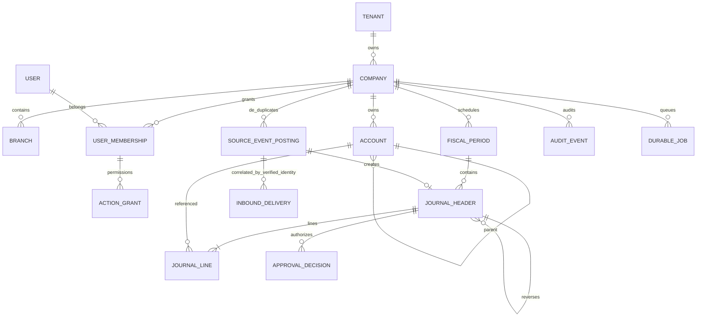

# Round 2 / R2-01 — Physical ERD and SQL Server integrity design (PROPOSED)

**Status:** Engineering proposal; NOT signed by Finance/Product/DBA and NOT a database migration.  
**Source:** user-owned reviewed SRS v1.2 (§12; F.4; GL-01/02; D-10), DEV-04, GAP-02/09/10/12/13/17.  
**Branch:** `development`. Do not edit `main` or the boss-owned original SRS.  
**Implementation gate:** D-10 company/branch/COA/period policy, DEC-004 recognition, DEC-006 FX, DEC-009 approvals.

## 1. Architectural decisions and unresolved alternatives

Use **one SQL Server OLTP database** as authoritative financial state, tenant-scoped relational keys, no database-per-tenant, no speculative microservice/event bus. Modular ASP.NET Core API owns transactions and business rules. Treat this layout as a **design candidate**, not permission to initialize a live tenant schema.

| ADR | Proposed design | Alternative / owner decision | Status |
| --- | --- | --- | --- |
| ERD-01 | Tenant and Company distinct; company is legal financial reporting boundary | Subscription ownership/business grouping | D-10 OPEN |
| ERD-02 | Branch belongs to one company; branches can share company COA and fiscal periods | Branch-specific COA/period rules | D-10 OPEN |
| ERD-03 | One posting transaction writes business state, SourceEventPosting, balanced journal and audit evidence | Review isolation/locking order and event ownership | DEC-004/009 OPEN |
| ERD-04 | Immutable posted journal; linked reversal never physically deletes or edits it | Authorized reopening/corrections | Finance OPEN |
| ERD-05 | Use `rowversion` on mutable drafts, period state and role grants; recheck all rights inside write | Exact version headers/grant expiry | Security OPEN |
| ERD-06 | Store currency values in `decimal` at explicitly approved scale and preserve original currency/rate | Exact p/s per entity, currency minor units, tax rules | DEC-006 OPEN |
| ERD-07 | SQL Server indexes and read models added when actual query plans show need | Cloud costs / Level-A/B dataset | Performance OPEN |

## 2. Core entities and ownership (candidate)

This graph illustrates business relationships only; physical FKs must enforce same tenant/company scope for each company-owned parent. SQL Server composite FK to an **optional nullable BranchId** does not enforce ownership for NULL values: an explicit business rule must decide when a branch is mandatory and restrict company-wide records.

## 3. Proposed exact physical keys and constraints (migration NOT created)

| Entity | Primary key / unique constraints | Important columns and restrictions |
| --- | --- | --- |
| Tenant | PK `TenantId` | Status, Legal/Subscription reference, RowVersion; users cannot change tenant identifiers on posted data |
| Company | PK `CompanyId`; UNIQUE (TenantId, CompanyId); candidate unique scoped CR code per jurisdiction | TenantId NOT NULL; LegalNameEn/Ar, BaseCurrency `char(3)`, LegalTimezone, Status, RowVersion |
| Branch | PK `BranchId`; UNIQUE (TenantId,CompanyId,BranchId); UNIQUE (TenantId,CompanyId,Code) | Company FK scope, Status, RowVersion; branch deactivation cannot silently strand posted records |
| FiscalPeriod | PK `PeriodId`; UNIQUE (TenantId,CompanyId,PeriodId); candidate unique fiscal period code | StartDate/EndDate, State (Open/Closing/Closed/Reopening), RowVersion; enforce start ≤ end and no overlapping active periods using serialized procedure/transaction |
| Account | PK `AccountId`; UNIQUE (TenantId,CompanyId,AccountId); UNIQUE (TenantId,CompanyId,Code) | ParentId self-FK in same company, Type, NormalSide, Postable, Status, RowVersion; no tree cycles checked transactionally |
| UserMembership | PK `MembershipId`; unique active user+company scope | TenantId,CompanyId,UserId, effective dates, revocation and version; independent security checks |
| ActionGrant | PK `GrantId`; uniqueness depends on policy version | MembershipId, ActionKey, Branch/Period/Type scope, AllowedMaxAmount, ValidFrom/To, PolicyVersion, RowVersion |
| SourceEventPosting | PK `PostingEventId`; **UNIQUE (TenantId,CompanyId,EventType,CanonicalEconomicEventId)** | Canonical PayloadHash `binary(32)`, approved posting owner, source document and version, state. JournalHeader references SourceEventPosting uniquely. Do not also add a mandatory reverse JournalId FK (circular insert dependency). SourceSystem is NOT part of financial event uniqueness. |
| InboundDelivery (only if integration enabled) | PK `DeliveryId`; UNIQUE (TenantId,CompanyId,IntegrationId,ExternalMessageId) | External SourceSystem/ExternalEventId, payload hash, VerifiedPostingEventId, Received/Correlated/Quarantined. Never post an uncorrelated delivery or guess a match from amount/date alone. |
| JournalHeader | PK `JournalId`; UNIQUE (TenantId,CompanyId,JournalId); UNIQUE company+fiscal series+VoucherNo **after signed numbering policy** | TenantId/CompanyId/PeriodId, SourceEventPostingId, Status, PostingDate, ApprovalRef, ReversesJournalId, RowVersion for draft only |
| JournalLine | PK `LineId`; scoped JournalId and AccountId composite FKs | LineNo, DebitFunctional, CreditFunctional, OriginalAmount, OriginalCurrency, FXRate, RateDate, dimensions, cost/event refs; zero/negative/single-side line rules require Finance approval |
| ApprovalDecision | PK `DecisionId` | Tenant/Company, object type/id/version, candidate hash where relevant, actor, decision, reason, EffectivePolicyVersion; maker ≠ checker where controlled |
| AuditEvent | PK `AuditEventId` | Actor, tenant/company, object/action, UTC time, safe before/after hashes or redacted fields, correlation; append-only by application DB permissions |
| DurableJob | PK `JobId`; optional unique (CompanyId,JobType,SourceEventId) | Scope, Purpose, PayloadReference, State, Attempt, LeaseUntil, RowVersion, RequestedBy, DeliveryGrantCheck; persisted before worker processing |

Additional future entities must be created **only with approved workflows**: Customer, Supplier, Invoice, ReceiptAllocation, StockLedger, CostLayer, BankReconciliation, StatementSnapshot, Taxonomy, FilingVersion, EvidenceFile and regulator Receipt. Each must maintain parent company scope, period/source version, audit lineage and permission checks.

## 4. Database verification invariants

1. `JournalHeader` company, period and every `JournalLine.AccountId` resolve to the SAME tenant/company, using composite FKs and scoped checks; a generic `AccountId` alone must not reference another company.
2. One **canonical economic event**, regardless of POS/ERP transport source, produces its original committed journal at most once, independent of document revision. Same verified canonical key and payload hash replay returns original JournalId; changed hash yields conflict, not another journal. External delivery and request keys are separate. If cross-source alias verification is impossible, quarantine pending authorized reconciliation.
3. Within a posting transaction, periods/accounts/approvals remain allowed, and `sum(DebitFunctional) = sum(CreditFunctional)` at the APPROVED company functional-currency precision. SQL CHECK cannot enforce cross-row sums; use one trusted posting use case and DB least-privilege controls.
4. Posted journals and original account references are immutable and cannot be updated through any ordinary API or background job. A reversal is a NEW posting event and linked JournalHeader, with authorized open-period date.
5. `FiscalPeriod` closing and posting synchronize on the same scoped resource/locking order. Read checks outside the transaction do not prove authorization at commit.
6. Parent Account cycle detection, invoice number issuance, allocation outstanding limits and stock valuation layer access are concurrency-sensitive, not client-only validation.
7. `rowversion` tracks mutation conflicts, **not historical accounting effective dates**. Financial statement snapshot lineage separately binds exact posting cutoff and mapping version.
8. Do not physically delete financial data through `ON DELETE CASCADE`; define separate legal retention and audited correction/offboarding.
9. Index keys follow real `WHERE (TenantId,CompanyId,...)`, `ORDER BY PostingDate,JournalId,LineId` and query plan tests; avoid one index per screen or redundant coverage on heavily written journal lines.
10. Audit events and required async job records must be crash-safe with their originating financial action, without unproven in-memory enqueue.

## 5. SQL Server implementation considerations

- Use explicit `decimal(p,s)` for transaction amount, base amount, price, rate and quantity separately. `float`, `real` and JS binary float are not acceptable financial storage; confirm max values/overflow and scale policy with Finance.
- Keep database timestamps UTC via `datetime2(3)` or an approved equivalent and reporting timezone separate; `date` for posting date rather than local server time assumptions.
- For company ledger search, candidate key order: `(TenantId, CompanyId, PostingDate, JournalId)`, and line drilldown `(TenantId,CompanyId,AccountId,PostingDate,JournalId,LineId)`. Actual join path selectivity, INCLUDE and index write amplification must be measured.
- Do not store every journal line's currently computed running balance as a mutable duplicate authoritative total. If a summary table is added after profiling, it is a derived read model with reconciliation and version/freshness controls.
- Migration PR must include DDL, backup/rollback or safe forward repair, realistic lock/downtime budget, backfill strategy, reversible release sequence and SQL Query Store baseline.

## 6. Before any migration can be written

**Approval artifacts required:** D-10 entity/branch ownership, Finance's GL and currency p/s decisions, DEC-009 grants, mutually exclusive posting roles, exact domain event keys, correct first edition and company activation constraints. **Tests required:** TC-016/020/021/022/028/030/062/064/065/066/072/081/083/089. **Status:** Proposed; NOT approved; NOT migrated.

## 7. Traceability

SRS §12, F.4, GL-01/02, CONS-04/09, J-02/04/05/12; [DEV-04](../DEV-04-database-erd-sql.md) and [Gap Register](../PRE-CODE-GAP-REGISTER.md). GitHub issues #8 and #10.
