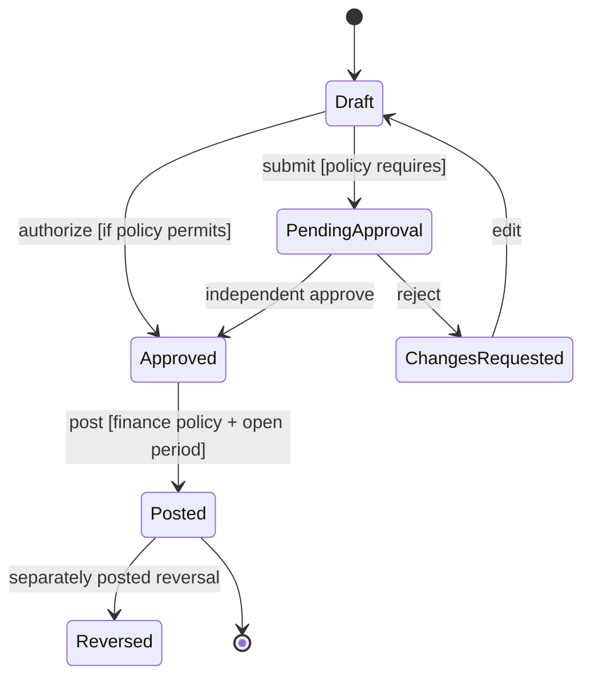

# Round 2 / R2-02 — Accounting event, posting and state contracts (PROPOSED)

**Status:** Engineering controls proposed; accounting recognition/account selection still **OPEN for Finance approval**. No financial application code is enabled.  
**Sources:** SRS GL-01–05, ARAP-01–03, GLM-00–15, PM-01–10, DEC-004/005/006/009; DEV-03; GAP-09/10/11/12/17.  
**Rule:** One authoritative posting use case. Do not implement one engine each for Sales, POS, Inventory or Purchases.

## 1. State machines — mutually distinct facts

Interpretation: a `Reversed` view is derived from linked immutable reversal posting; original journal header/lines stay Posted and unchanged. Approval ≠ recognition; sale/invoice/payment/stock workflows have distinct state machines, with recognition event boundaries signed per business event.

**Invalid transitions:** Draft→Posted without required maker-checker, PendingApproval→Posted by maker, Posted→Draft/Edit/Delete, Reversed→EditOriginal, approval after source hash/version changed, Post dated inside a closed period, or retry with changed payload under the same economic event key. API must return safe 409/422 instead of a success-looking view.

## 2. Economic event vs request retry vs document version

| Identifier | Meaning | Uniqueness and impact |
| --- | --- | --- |
| TenantId, CompanyId | financial ownership | Verified from authenticated membership; not trusted from body |
| SourceSystem | POS / manual GL / ERP / Sales, etc | Approved owner per event type |
| EventType | e.g. InvoiceRecognized, ReceiptPosted, StockIssued | Recognition event names require Finance signoff |
| StableEventId | immutable ID generated at occurrence | Identity survives document editing, retries and delivery |
| PayloadHash | canonical approved event body checksum | Same key/new hash causes conflict, not new posting |
| DocumentVersion | optimistic edit revision | Never part of posting uniqueness boundary |
| RequestIdempotencyKey | HTTP retry coalescing | Scoped and expiring per signed operations policy, distinct from StableEventId |
| JournalId | committed ledger reference | Stable original reference returned to exact retry |
| ReversesJournalId | correction linkage | New event creates linked reversal without editing original |

## 3. Atomic journal post — design algorithm, NOT production pseudocode

1. Authenticate; resolve tenant/company and current grants from authoritative storage; evaluate action, amount, SoD, and period.
2. In a bounded SQL transaction, lock/select affected fiscal period and source event key in a consistent order, validate company-scoped account eligibility and current approval/source hash.
3. Canonicalize and validate event payload, currency conversion precision and invariant of balanced functional debits/credits. Do not use an unapproved tax, valuation or FX policy.
4. Insert or resolve unique stable source-event posting key. On exact same-key/same-hash already Posted, return original journal reference (and HTTP semantics per contract). On key/hash mismatch, reject with 409 `EVENT_PAYLOAD_CONFLICT`; on transient uniqueness race, reload committed original. **Replay ordering:** after authenticating and enforcing current permission to access the original company/action outcome, an exact replay may return the already-committed reference despite an obsolete draft `If-Match`; do not re-run posting, approve again, or recalculate under a newer policy. A changed payload must not evade the stale-version or hash conflict check.
5. For the first valid event, insert JournalHeader and JournalLines, source-state and immutable audit record; persist any required durable job in the same transaction (or equivalent proven atomic handoff), then commit.
6. Return committed JournalId, source event identity, version/correlation and allowed actions. An HTTP timeout does not mean posting failed; server-side retries must be safe.
7. Reversal is a new approved event, current period must be open, link to original and disallow double reverse/correction under signed policy.

**Canonical hash rule (draft):** compute a deterministic hash from immutable financial event type, stable event ID, legal company, line amounts/currencies, recognized posting date and effective policy snapshot; exclude request retry IDs and mutable UI draft-version metadata. Exact canonical field list and serializer version must be signed before code. Store first committed hash/policy version and never hash a new current policy over an old event when checking identical retry. This avoids double posting after permission or policy changes while still checking current authorization for disclosing the original result.

## 4. Concrete **design-only** fixture examples

| Scenario | Sample inputs | Expected invariant | Policy status |
| --- | --- | --- | --- |
| Manual balanced journal | Dr 100.000 KWD and Cr 100.000 KWD, two accounts same company, open period | Totals balanced; one immutable post; original ID on replay | Engineering invariant; role/approval/account selection OPEN |
| Unbalanced draft | Dr 100.000, Cr 99.999 KWD | Reject posting; difference 0.001 and no JournalLine write | Engineering invariant |
| Same event sent 100 times | stable key `manual-001`, identical canonical hash | Exactly one journal and identical committed reference; no retries alter debit/credit | Engineering invariant |
| Same event changed payload | stable key `manual-001`, a different hash | HTTP 409; no second journal, request authorized correction | Engineering invariant |
| Receipt partially allocated | Invoice 100.000 KWD; posted receipt 40.000 KWD, no other credits | Outstanding 60.000; allocation never re-debits bank | Proposed math example; final recognition policy OPEN |
| Stock sold + POS replay | Same approved sale/stock issue event delivered by POS and ERP | One designated COGS publisher and stock valuation applied once | Source owner/costing DEC-005 OPEN |
| Period close race | Two users post/close same company period concurrently | Either authorized post completes before close or post fails; never committed into already-closed state | SQL locking design pending |
| Historical reversal | Closed original period, authorized reversal current open period | Original remains unchanged; separate dated reversal with reference | Authorized reversal rules OPEN |

These are **synthetic assertions** to help Finance approve a policy, not tax advice or proof of working functionality.

## 5. Policy-by-event approval matrix

| Event family | Source owner / recognition trigger | GL sample and exceptions | Decision blocking enablement |
| --- | --- | --- | --- |
| Manual journal | Accounting Posting Engine; approval and `Post` required | balanced chart-of-accounts lines | DEC-004/009 |
| Cash sale | Sales/POS designated source event | Dr cash/Cr revenue; tax where applicable | DEC-004, tax applicability |
| Credit sale | Sales invoice recognition, not quotation | Dr AR/Cr revenue per policy | DEC-004 |
| Stock issue | Inventory delivery/issue event | Dr COGS/Cr inventory at approved cost | DEC-005 |
| Customer receipt | Banking/Receivables settlement event | Dr bank/Cr AR or advance liability | DEC-004/006 |
| Apply advance | Receivables allocation event | Liability→AR clearing if separately authorized; not double bank | DEC-004 |
| Sales return/credit | Original invoice + stock reference | Revenue/AR/tax correction; stock/COGS if restockable | DEC-004/005 |
| PO and goods receipt | Purchase source; PO normally nonposting | Inventory/GRNI under selected perpetual policy | DEC-004/005 |
| Supplier bill | AP source and matching | GRNI/expense/inventory/AP variance as policy | DEC-004/005 |
| Supplier payment | Banking/AP settlement | AP/bank; advance policy separately | DEC-004/006 |
| Inventory count | Inventory variance source | authorized cost layer variance | DEC-005 |
| Bank internal transfer | Banking source | source→destination; in transit if required | DEC-004 |
| Fixed asset/depreciation | Asset register | capitalization/contra/expense; disposal | DEC-004 |
| Accrual/prepayment | Closing source | accrued liability/prepaid amortization | DEC-004 |
| FX settlement/revaluation | Period & source monetary balances | realized/unrealized FX accounts | DEC-006 |
| Opening/closing | Approved opening evidence | balanced opening and carry-forward | DEC-004/010 |
| Payroll import | HRMS event owner | signed liabilities and expense map, no payroll engine | DEC-004 |
| Integration correction | Source owner and event registry | separate linked reversal/adjustment | DEC-004/009 |

## 6. Readiness blockers and user experience contract

The UI `Post` action is present only if the actor has permission, source is valid and finance policy authorizes it. Display server-confirmed status only, not optimistic green Posted. On conflict, focus exact cause; preserve draft; do not hide locked-period explanation or make users retry payment blindly. Reviewers must see amount, period, source, GL lines, maker identity and exact policy version. Requires independent signoff.

**Traceability:** TC-001–003, 019, 021–029, 055, 062, 064–069, 074/076, 083; [DEV-03](../DEV-03-accounting-posting-controls.md), [GAP register](../PRE-CODE-GAP-REGISTER.md); issues #9/#10/#13. 
