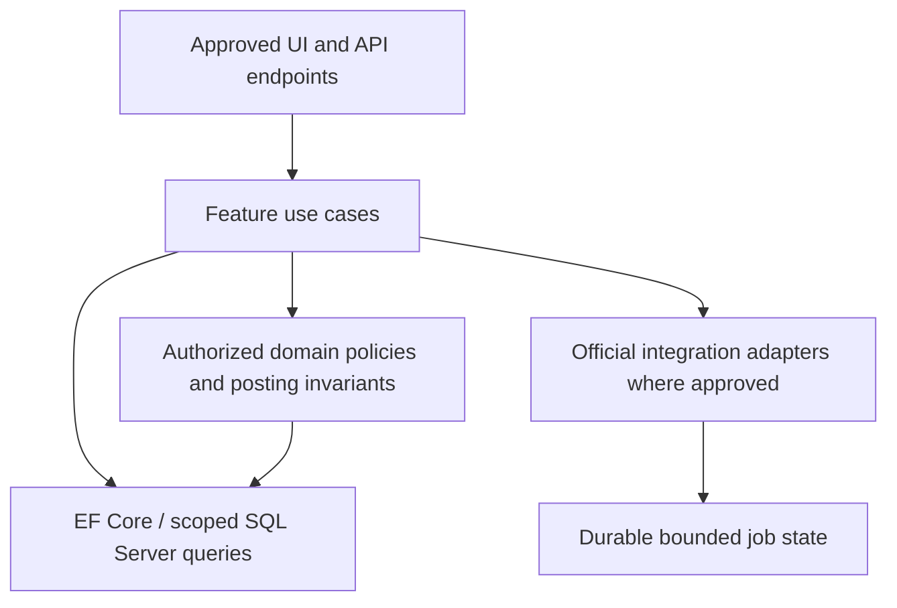

# Round 2 / R2-08 — Feature Code Ownership & Dependency Map (DRAFT)

**Status:** Proposed implementation location and module ownership, NOT folders/classes already present or sign-off to code. The existing repo contains only a minimal `src/Keifac.Api/Program.cs` health API.  
**Sources:** User-owned SRS §14/F.1, DEV-00/01/02/03/04/05/10, GAP-01/04/09/14.  
**Goal:** Every approved feature has one owning module for its business use case, no duplicate rules or speculative abstractions. **Frontend architecture remains D-01 OPEN.**

## 1. One deployable ASP.NET Core modular monolith

**Proposed code convention only** (create a folder when implementing a signed feature, not upfront):

```text
src/
  Keifac.Api/
    Program.cs                          # Only health route exists today
    Features/
      Identity/                          # Principal/context and role membership
      Organization/                      # Tenant/company/branch activation
      Periods/                           # Fiscal years, locking and close
      Accounting/                        # COA, journals, ONE posting engine
      Sales/                             # Sales documents, receipts, allocation
      Purchases/                         # Supplier bills, payment, credits
      Inventory/                         # Item/stock/cost layers
      Banking/                           # Cash/bank import and reconciliation
      Reporting/                         # TB, snapshots and reports
      Xbrl/                              # Taxonomy/mapping/facts/validation
      Filing/                            # Obligation, package submission state
      Approvals/                         # Shared maker-checker decisions
      Audit/                             # Scoped audit/evidence
      Integrations/                      # External source events and job retries
    Infrastructure/
      Persistence/                       # One EF Core context initially, SQL migrations
      Authentication/                    # Approved IdP adapter only
      BackgroundJobs/                    # Durable DB job records and bounded worker
    Shared/
      Authorization/                     # Scoped principal/action checking
      ErrorContracts/                    # Safe problem response
      Money/                             # Approved money arithmetic primitives
      Paging/                            # Bounded keyset paging primitives
tests/
  Keifac.Api.UnitTests/                  # Create only when real policies exist
  Keifac.Api.IntegrationTests/           # SQL Server, event duplication, tenancy
  Keifac.Ui.E2ETests/                    # Create only after frontend decision
```

Keep one application process initially, not one deployable service per folder. Favor cohesive feature code and direct EF Core queries over over-designed `IRepository<T>`, mediators, distributed brokers or duplicated DTO hierarchies. Use interfaces ONLY for real dependencies that need isolation/testing (e.g. external identity, time, official regulator provider). Do not mix accounting recognition logic into UI components or DB triggers.

## 2. All 38 screen IDs → owning source folder

The owning module listed here means **backend use case ownership**, NOT a separate page or class per screen. Multiple screens may call the same approved use case. Logical SRS F.1 entities, grant and tests are included for traceability.

| Screen | Backend feature owner | Proposed source location | Candidate data entities | SRS logical action permission | Relevant test IDs | Posting responsibility |
| --- | --- | --- | --- | --- | --- | --- |
| SCR-001 | Identity | `Features/Identity/` | User,Session,MfaChallenge | Authenticate | TC-016,020,059,060 | Owned use case; no duplicate ledger |
| SCR-002 | Reporting | `Features/Reporting/` | Company,Period,JournalLine,ReportSnapshot | ViewDashboard | TC-004,020 | Owned use case; no duplicate ledger |
| SCR-003 | Organization | `Features/Organization/` | Tenant,Company,Branch | ManageCompany | TC-020,030 | Owned use case; no duplicate ledger |
| SCR-004 | Accounting | `Features/Accounting/` | Account,AccountGroup | ManageCOA | TC-001,005 | Authoritative Accounting/Posting where financial |
| SCR-005 | Accounting | `Features/Accounting/` | JournalHeader,JournalLine,Approval | CreateDraft,Post,Reverse | TC-001,002,003,021,028,062 | Authoritative Accounting/Posting where financial |
| SCR-006 | Sales | `Features/Sales/` | SalesDocument,SalesLine,JournalHeader | IssueSalesInvoice | TC-023,055 | Owned use case; no duplicate ledger |
| SCR-007 | Purchases | `Features/Purchases/` | PurchaseDocument,PurchaseLine,GoodsReceipt | ApproveSupplierBill | TC-024,055 | Owned use case; no duplicate ledger |
| SCR-008 | Banking | `Features/Banking/` | BankStatement,BankStatementLine,Reconciliation | ReconcileBank | TC-027 | Owned use case; no duplicate ledger |
| SCR-009 | Reporting | `Features/Reporting/` | FinancialStatement,StatementLine,StatementVersion | ApproveStatement | TC-005,031,052 | Owned use case; no duplicate ledger |
| SCR-010 | Filing | `Features/Filing/` | Regulator,EntityProfile,FilingObligation | ManageRegulatoryProfile | TC-049 | Owned use case; no duplicate ledger |
| SCR-011 | Xbrl | `Features/Xbrl/` | Taxonomy,TaxonomyConcept,TaxonomyRelationship | ApproveTaxonomy | TC-011,032 | Owned use case; no duplicate ledger |
| SCR-012 | Xbrl | `Features/Xbrl/` | XBRLMapping,MappingDimension | ApproveMapping | TC-006,007,032 | Owned use case; no duplicate ledger |
| SCR-013 | Xbrl | `Features/Xbrl/` | Disclosure,DisclosureAttachment | EditDisclosure | TC-033 | Owned use case; no duplicate ledger |
| SCR-014 | Xbrl | `Features/Xbrl/` | ValidationRun,ValidationIssue | RunValidation | TC-008,009,010,012 | Owned use case; no duplicate ledger |
| SCR-015 | Xbrl | `Features/Xbrl/` | XBRLFact,XBRLContext,FilingVersion | ViewFiling | TC-039,051 | Owned use case; no duplicate ledger |
| SCR-016 | Xbrl | `Features/Xbrl/` | XBRLPackage,FilingVersion,Approval | GeneratePackage,ExportPackage | TC-010,013,031,051,061 | Owned use case; no duplicate ledger |
| SCR-017 | Approvals | `Features/Approvals/` | Approval,XBRLPackage,FilingVersion | ApprovePackage | TC-029,042,054,061 | Owned use case; no duplicate ledger |
| SCR-018 | Filing | `Features/Filing/` | Submission,Receipt,FilingVersion | RecordSubmission | TC-014,015,034 | Owned use case; no duplicate ledger |
| SCR-019 | Audit | `Features/Audit/` | AuditLog | ViewAudit | TC-016,038 | Owned use case; no duplicate ledger |
| SCR-020 | Reporting | `Features/Reporting/` | ReportDefinition,ReportRun | RunReport,ExportReport | TC-004,005,045 | Owned use case; no duplicate ledger |
| SCR-021 | Organization | `Features/Organization/` | Tenant,Company,FiscalYear,Account | ActivateCompany | TC-030 | Owned use case; no duplicate ledger |
| SCR-022 | Identity | `Features/Identity/` | User,Membership,Role,Permission,ApprovalPolicy | ManageRoles | TC-020,029 | Owned use case; no duplicate ledger |
| SCR-023 | Periods | `Features/Periods/` | FiscalYear,Period,ExchangeRatePolicy | ManagePeriods | TC-003,022 | Owned use case; no duplicate ledger |
| SCR-024 | Accounting | `Features/Accounting/` | JournalHeader,JournalLine | ViewJournal | TC-021 | Authoritative Accounting/Posting where financial |
| SCR-025 | Sales | `Features/Sales/` | Receipt,ReceiptAllocation,JournalHeader | AllocateReceipt | TC-023 | Owned use case; no duplicate ledger |
| SCR-026 | Sales | `Features/Sales/` | Customer,SalesDocument,ReceiptAllocation | IssueCreditNote | TC-023,025 | Owned use case; no duplicate ledger |
| SCR-027 | Purchases | `Features/Purchases/` | SupplierPayment,PaymentAllocation | AllocatePayment | TC-024 | Owned use case; no duplicate ledger |
| SCR-028 | Purchases | `Features/Purchases/` | Supplier,PurchaseDocument,PaymentAllocation | IssueSupplierCredit | TC-024 | Owned use case; no duplicate ledger |
| SCR-029 | Inventory | `Features/Inventory/` | Item,Warehouse,StockLedger,CostLayer | ManageInventory | TC-025,026 | Owned use case; no duplicate ledger |
| SCR-030 | Inventory | `Features/Inventory/` | GoodsReceipt,StockMovement,StockCount | PostStockMovement | TC-025,026,041 | Owned use case; no duplicate ledger |
| SCR-031 | Banking | `Features/Banking/` | BankAccount,CashBankTransaction,JournalHeader | ManageCashBank | TC-027 | Owned use case; no duplicate ledger |
| SCR-032 | Periods | `Features/Periods/` | Period,CloseChecklist,Reconciliation | ClosePeriod | TC-022,027,045 | Owned use case; no duplicate ledger |
| SCR-033 | Approvals | `Features/Approvals/` | Approval,ApprovalPolicy | ApproveScopedAction | TC-029,042 | Owned use case; no duplicate ledger |
| SCR-034 | Audit | `Features/Audit/` | AuditEngagement,EvidenceRequest,DisclosureAttachment | ReviewEvidence | TC-038,047 | Owned use case; no duplicate ledger |
| SCR-035 | Integrations | `Features/Integrations/` | IntegrationJob,InboundEvent,DeadLetter | RetryIntegration | TC-019,044 | Owned use case; no duplicate ledger |
| SCR-036 | Filing | `Features/Filing/` | FilingObligation,FilingVersion,StatementVersion | PrepareFiling | TC-031,032,049,063 | Owned use case; no duplicate ledger |
| SCR-037 | Filing | `Features/Filing/` | Submission,Receipt,RegulatorDecision | ReconcileSubmission | TC-034,035,043,048 | Owned use case; no duplicate ledger |
| SCR-038 | Reporting | `Features/Reporting/` | ReportDefinition,ReportRun | ConfigureReport | TC-005,045 | Owned use case; no duplicate ledger |

**Special shared ownership:** SCR-017 Filing Approval and SCR-033 Unified Approval Inbox share `Features/Approvals/` with purpose-specific filter/permission, not two independent decision engines. SCR-020 Report Centre and SCR-038 Report Definition/Filter share `Features/Reporting/`; regulatory filing SCR-018/037 share `Features/Filing/`. Source journal posting always delegated to one `Features/Accounting/` use case. Each company-scoped module must use one shared principal/permission resolver without bypass.

## 3. UI module ownership remains conditional on D-01

Before creating `web/` or `frontend/`, inspect any approved reusable frontend/reference assets and select framework/build tool/runtime. Then define ONE shell/header/permission routing scheme, shared compact form/data grid, consistent error/empty/loading and Arabic RTL design tokens. Proposed UI paths might group by accounting, sales, purchasing, inventory, banking, reports and filing, but are **not hard-coded** until an owner approves the route tree.

A single short master editor handles create/edit with conditional actions; posting remains read-only after commit. For large lists, the UI uses server-scoped keyset/paged data and bounded rows; it never owns a second client-side authoritative ledger or financial total.

## 4. Dependency direction and build order



**Sequence:** (A) Signed organization/identity and action scope → (B) approved ERD and migration → (C) COA/period state → (D) immutable event/journal posting → (E) AR/AP/stock/bank source events → (F) report snapshots → (G) XBRL/regulatory workflows. A small API compile or code stub does not advance feature readiness.

## 5. Feature file-level contract template

```text
Requirement and SRS ID:
Edition/phase and screen ID:
Owning backend module (ONLY ONE):
Use case name / entrypoint:
API method + route + DTO + error:
SQL entities/constraints/index/read query:
Scope: tenant/company/branch/period/action/amount:
Source economic event and Finance policy version OR N/A:
Request idempotency / concurrency / reversal handling:
Frontend route/form/table component (when approved):
UI compactness/scroll/RTL/keyboard behavior:
Tests and expected data/ledger outputs:
Performance budget + benchmark fixture:
Existing code reused / duplication eliminated:
Approved reviewer / decision / date / commit:
Status: OPEN / DESIGN REVIEWED / READY / IMPLEMENTED / TESTED
```

## 6. No-code-yet implementation gate

This is a **directory ownership proposal**, not a request to create empty folders or a scaffold for each logical SRS entity. The exact physically approved module split and API contracts must reconcile with D-01/10 and DEC-001/004/005/006/009. Avoid fake dead code, duplicated components and massive speculative repository structures. All development stays in `development` only.

**Traceability:** [R2-03 OpenAPI](03-accounting-core.openapi.yaml), [R2-04 screens](04-SCREEN-FIELD-ACTION-AND-UX-CONTRACTS.md), [R2-01 ERD](01-PHYSICAL-ERD-DESIGN-PROPOSAL.md), [GAP register](../PRE-CODE-GAP-REGISTER.md). Existing GitHub issues #4, #7, #8, #9 and #10.
